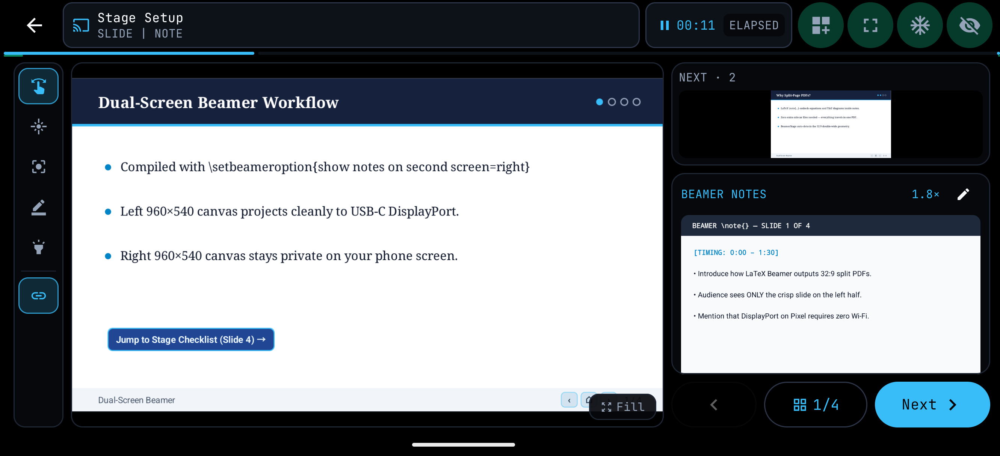
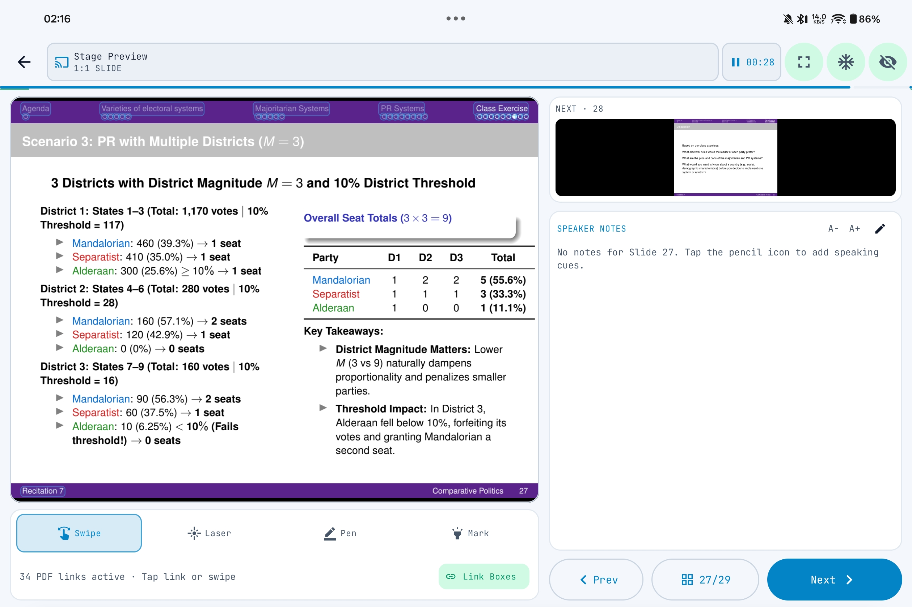
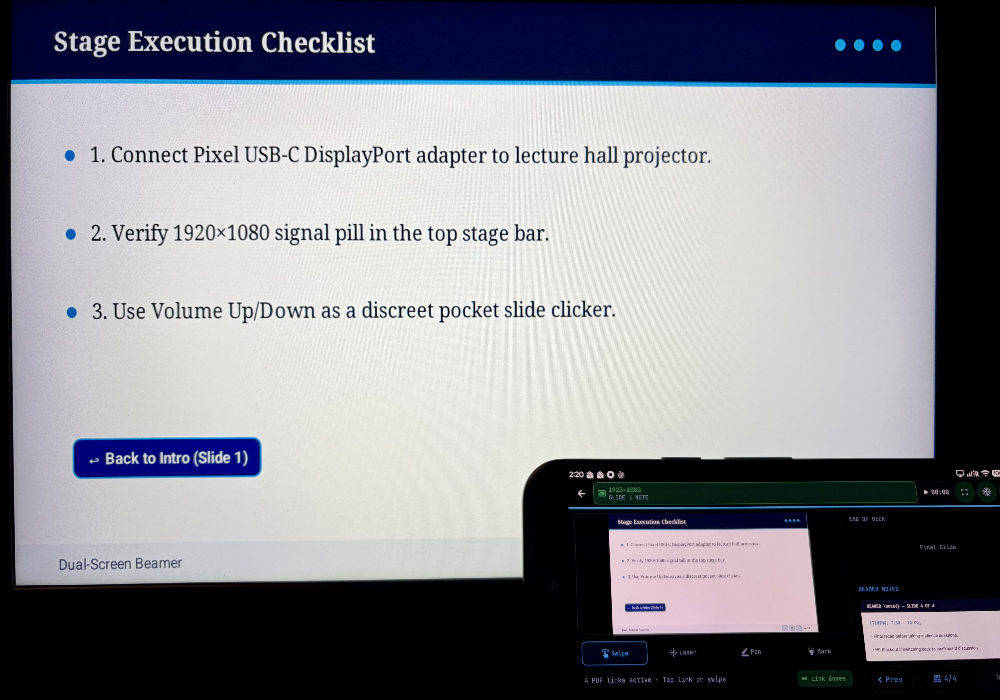

An android app for presenting LaTeX Beamers (pdf format slides). It supports external screen casting via DisplayPort (like usb-c on pixel devices or many tablets) to projectors while showing notes, controls, progress, laser pointer, and optional annotation tools on the device screen.
Vibe coded with Gemini.

